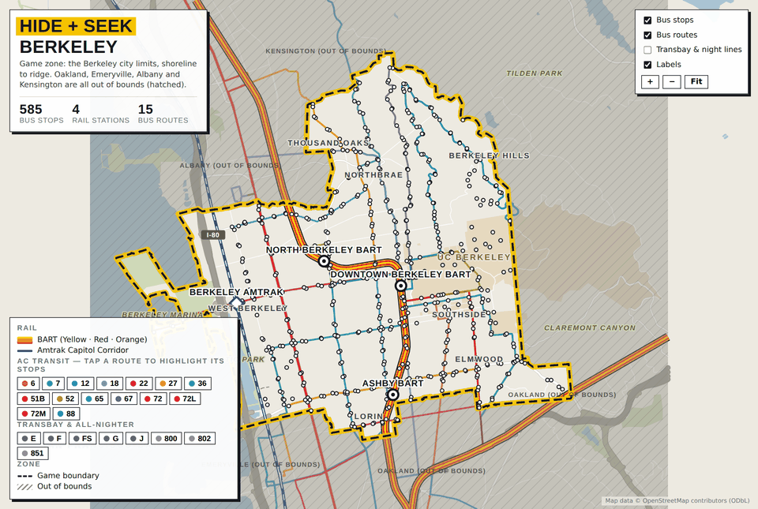

# Jet Lag: Hide + Seek — Berkeley

Maps and a phone companion for playing [Jet Lag: The Game](https://jetlagthegame.com/)'s
Hide + Seek in Berkeley and North Oakland, built from OpenStreetMap data.

There are two maps and one companion app. The maps show every bus stop and
rail station inside the game zone, drawn in the show's visual language —
dashed boundary, hatched out-of-bounds, one colour per bus line. The
companion is what the players actually hold during a round: seekers send
questions through it, the hider answers, and everything syncs across
phones. Neither tool works out where the hider is. That part is the game.



## The maps

`maps/berkeley.html` is the Berkeley city limits, shoreline to the Tilden
ridge: 585 bus stops, four rail stations, fifteen AC Transit lines. It fits
a small game — a 30-minute hiding period and a quarter-mile hiding zone.

`maps/berkeley-north-oakland.html` adds Oakland north of Highway 24: 714
stops, six stations. Bigger, and it brings Rockridge and MacArthur BART
into play.

With GitHub Pages turned on they are served as a live site, which is the
easy way to open one on a phone mid-game.

Both are single self-contained HTML files. Open one in a browser and it
works offline from then on, which matters when you are on a platform with
one bar of signal. Drag to pan, pinch or scroll to zoom, hover or tap a
stop for its name and routes, and tap a route chip in the legend to
highlight just that line and the stops it serves. Zoom past about three
times the framing view and the minor street network fades in, so a stop
stops being a dot in space and becomes a corner you can walk to; zoomed
out it stays off, where it would only grey the map over.

### Where the boundary comes from

Berkeley's zone is the city limits, trimmed at the shoreline — the legal
boundary runs out into the bay, and a line drawn across open water is a
line nobody can walk.

"Oakland north of Highway 24" needed more care, because that is not a line
OpenStreetMap hands you. CA-24 is mapped as one way per carriageway with
gaps at every interchange, so the pieces get unioned and buffered into a
single ribbon before they can cut anything. The bigger problem is that
CA-24 ends at the I-580/I-980 interchange, about a mile short of the
Oakland city line: cut there and the boundary leaks, and the "northern"
piece comes back as the entire city. The cut therefore continues west along
I-580 to the Emeryville line, with a short connector closing the gap at the
interchange. That whole line is drawn on the map as a faint band under the
boundary so you can see what the rule actually means on the ground.

Rockridge and MacArthur BART sit in the freeway median right on that
boundary. They are drawn and marked `(edge)` rather than quietly included
or excluded — whether they count is a house rule, not something a map
should decide for you.

## The companion

`companion/index.html` is a phone app for running a round, served straight
from the site. Everyone opens it, picks a name and a role, and creates or
joins a game with a four-letter code — nothing to install and nothing to
sign in to.

Seekers pick from the real question deck — Matching, Measuring, Radar,
Thermometer, Photo, and Tentacles in medium and large games — and send a
question. It lands in the hider's inbox with the draw-and-keep count for
that category. The hider taps Yes/No, Closer/Further, Hotter/Colder, takes
a photo straight from the camera, or vetoes. The answer flows back to a
shared feed on every phone. The hider logs the cards they keep and can send
curses and notes. The status card runs the hiding-period countdown and the
hider's clock, and finished rounds land on a scoreboard.

The hider's hand is private — seekers see neither the cards nor how many
there are. They find out when something gets played.

Radars, measuring and thermometers record where the seeker was standing,
because the answer means nothing without it. Tentacles offer the hider the
places of that type actually within range of where the seeker asked, plus
"not within reach" — which is a valid answer under the rules, and a strong
one, because it rules out the whole circle. Thermometers follow the real
two-leg procedure rather than being a single tap: starting one sends the
hider your position immediately, you travel, and only once the app confirms
you have covered the distance as the crow flies does the question actually
go out, carrying both endpoints.

Photo answers go through the same sync as everything else. The camera
produces a file far too big for a public broker, so the photo is re-encoded
in the browser — 1280 px on its long side, quality stepped down until it
fits about 110 KB — and sent as its own document, which both public brokers
accept and retain. Opened as a claude.ai artifact it uses the real asset
store instead and skips the re-encoding. Either way the seekers see the
photo in the feed, and "describe instead" is there for when the shot is
impossible.

Question text, category draw counts, hiding periods, zone radii and photo
time limits follow the published Hide + Seek rules; the size of the game
switches which cards are available.

A Map tab carries both game zones — every stop, the boundary, the street
network, your own location from GPS, and a quarter-mile hiding-zone circle
the hider can drop on whichever stop they picked. Anyone can drop a labelled
pin, which syncs to everyone.

### What the answers rule out

Answers narrow the map, for seekers and hider alike, and every phone narrows
it the same way. What greys out is the ground, not the stations: the hider
has to be inside a hiding zone around one of the stations still in play, so
everything outside those zones is shaded over, leaving the area still worth
searching. A counter says how many stations are left, a Zones control
outlines each surviving zone separately, and tapping a stop lets you rule it
out by hand for the deductions the app cannot make.

New rounds read answers **station by station** — sharper, and how people
actually play. The Game tab switches to the rulebook reading. The rest of
this section explains the difference, and it is a real one: in one played
round, read by the book 25 stations survived; read station by station,
nothing did, because one answer was wrong. The app says so now instead of
showing an empty map — it names the answers that, dropped, would bring the
map back.

The rulebook decides how much an answer rules out, and it is explicit:
*"radars are asking about your location, not your hiding zone. If the radar
would encompass part of your hiding zone, but not your location at the time
of answering, it would be a miss."* The hider may also move freely anywhere
in their zone until the end game. So a station falls only when **no point at
all** of its zone could have produced the answer — which is why a quarter-mile
radar answered "no" rules out almost nothing, and that is correct. A **Station**
setting on the Game tab reads answers against the station instead, ruling out
everything inside that circle; it is sharper, it is how people tend to play,
and it is a house rule, so it says so.

The geometry is exact, and it no longer runs on a grid. Each answer becomes
the region of points that could have produced it — a disc for a radar, a
half-plane for a thermometer, a union of discs for a measuring card, a Voronoi
cell for a matching or tentacle card, a city outline for an administrative
one — and that region is expressed as a clearance function: at or above zero
exactly where the answer is possible, and never changing faster than distance
itself. A station survives when some point of its hiding zone sits at or above
zero. Because the function is Lipschitz, a square whose centre sits further
below zero than its own half-diagonal cannot contain a qualifying point
anywhere, so the search discards it whole and never has to look inside. What
comes back is a proof, not a sample: nothing is padded, nothing is rounded to
a cell, and every elimination is as certain as every other.

It is checked against an independent implementation that samples each hiding
zone densely and decides membership from the rules directly — for streets,
water and metro lines by brute force over every segment rather than through
the app's indexes. Across 260 random answers of every kind, in both zones, at
all three game sizes and in both reading modes, 9,000 station verdicts came
back with no station eliminated that had a qualifying point. Separately, every
card in the deck was asked and answered truthfully by the app's own hider
helper, round after round — about 5,400 answers across 148 rounds, seekers
both far from the hider and right next to them — and not one eliminated the
station the hider was actually hiding at.

The map itself is a real slippy map. Leaflet carries the tiles; everything
the app draws rides on top in two layers. The shading, zone and answer
outlines are one SVG that the compositor scales during a gesture and that is
redrawn once when it ends. The stations, labels, pins and markers are a
second SVG re-placed on every frame, with each stop a dot of one round-capped
path whose width is set in screen pixels, so nothing swells and snaps back.
Every zoom — mouse wheel, trackpad pinch and scroll, two-finger pinch,
double-tap, the buttons — moves the map frame by frame through one path
(Leaflet's own pinch, or a small controller using the same per-frame move),
never by a CSS jump between two levels. It is tested by driving each gesture
through the browser's input pipeline and checking every frame: zoom changes
in steps of under a tenth of a level, markers stay exactly 13 px, and the
drawing lands within a pixel or two of where Leaflet puts the same point. That works because the drawing was already in Web Mercator metres, the
same space Leaflet projects into, so at any zoom the step from map units to
screen is one scale and one translate and every path is reused untouched.
Basemaps cycle through Street, Dark, Terrain, Satellite and Paper; Paper is
the hand-drawn basemap the app has always carried, and it is also what you
get if Leaflet never loads, which is the case worth designing for on a phone
with no signal at the start of a round.

Stations that are out go grey on the map, not just the ground around them,
and the Stops button cycles through every station, only the ones still
possible, and none. Measuring questions draw the thing they measure to —
the county line as a line, places as points, one ring at the distance that
was matched — rather than a ring around every reference on the map, which
was 47 overlapping circles for the county line. A thermometer draws its
bisector thick, with the leg you travelled dashed beside it.

**Alerts.** The phone buzzes and shows a notification when a question lands
in the hider's inbox, when an answer comes back, when a curse or a note is
sent, and when the hiding period or a photo's time limit is nearly up —
with the app in the background, which is where it will be. On an iPhone
that means adding the page to the Home Screen first; Safari only delivers
notifications to an installed page, and the manifest and icons are there
for it. While the app is open on screen it just buzzes and toasts.

**The map, stripped back.** One button cycles the drawing: everything, then
only the grey that says where the hider cannot be, then the plain map with
its stations. Ruling out by hand works on a whole street or everything
within a quarter mile of a stop, not one stop at a time, and it syncs like
everything else.

**Nothing is lost to a dropped signal.** Every write lands on your own phone
first and goes into an outbox; the app says how many are waiting and sends
them when the connection comes back. You can run a whole round in the hills
with no bars — asking, answering, the map narrowing — and it syncs when you
drive out. Each phone also keeps the round as it last saw it, and can push
that copy back to the relay: the free relay forgets after twelve hours, and
a round that outlives it is one button, not a lost evening.

**Joining.** The Game tab shows the round's code as a QR code; a phone
camera opens it, sets the relay up from the link and joins. Nobody types
four letters in a moving car.

**Saving a round.** The Game tab writes the round to a file — the questions,
the answers, the pins, what was crossed off — for arguing about afterwards
or replaying later.

The Game tab carries a **Testing** card, because none of this should need
two people and a car to try. **Run self-check** reports what survives, what
each answer ruled out, whether your own station is still standing, and spot
checks the exact engine against brute-force sampling of the hiding zones.
**Fill a demo round** picks a station at random and answers six questions
truthfully from it, so the map, the panels and the feed have something in
them. A slider steps back through the answers one at a time.

Two panels read the map back to you. **Layers** lists every answer that has
geometry, each in its own colour, drawn as the line it actually cut along: a
radar's circle, a thermometer's bisector, the real Voronoi cell of a matching
card, the outline of a city. Turn one off and its drawing goes; what is ruled
out does not move, because that is a fact about the answers and not about
what you are looking at. **Stations** lists the stops still standing, and the
list and the map stay in step — tap a row and the map goes there, tap a stop
and the list scrolls to it.

Two kinds of grey, kept apart on purpose. **Solid** grey is ground no
surviving hiding zone reaches: the stations there are out for good.
**Light grey** is what a single answer excludes for the moment it was
given — a radar's "no" means the hider was not inside that circle *then*. The
rules let the hider move anywhere within their own zone between questions, so
the light grey is exact about that moment and claims nothing beyond it. That is why
a quarter-mile radar answered "no" shades its whole circle while ruling out
no station on its own — every zone near the circle still has ground outside
it — and the feed says both of those things under the answer.

### Every card, and what it reads

Every question shows the seeker their own side before it is sent — your
nearest park and how far, the line you are riding, your station and its
length, your elevation — and that side travels with the question, so the
hider and the feed see exactly what was compared. The hider's inbox works
out the hider's side from the same data, from their hiding station by
default or from GPS or a tap on the map, and highlights the answer that
follows. The hider's position never leaves their phone. Both sides run the
same code, and comparisons are made in the same units the map narrows in, so
a truthful answer can never rule out the station it came from.

**Matching.** Parks, mountains, museums, cinemas, hospitals and libraries
are the nearest one, and narrow by its Voronoi cell. **Transit line** follows
the card: the seeker has to be riding it, picks it from the lines that stop
near them, and Yes means it stops at the hider's station — read off each
station's own route list, with BART and Amtrak stations carrying their lines.
**Station name length** is the hider's station against the one the seeker
picks (spaces and hyphens count). **Street or path** follows the rulebook's
definition: a named street runs for as long as its name does — pieces of one
name within 1 km of each other are one street, because Berkeley's traffic
diverters break the mapped line every few blocks — and an unnamed one ends
at every intersection; sidewalks, crossings and driveways belong to the
street beside them. The chosen street is drawn on the map. **City** and
**district** are the containing outline. **State**, **county** and
**landmass** are always Yes on this map — all of it is in California, in
Alameda County (Contra Costa's line runs along the map's own edge in the
hills), on one landmass — and the app says so before you spend one.

**Measuring.** Distances to the nearest museum, park and so on, to the
nearest **rail station**, and to the **county line**, which runs along the
ridge. **Body of water** is any named water on the map — Aquatic Park's
lagoons, the Botanical Garden's pond, and San Francisco Bay measured to its
shoreline — excluding pools and fountains, per the card. **Sea level** is
elevation from a terrain model (AWS terrain tiles, USGS 3DEP). Because height
is not a distance, the engine divides it by the steepest slope anywhere in
the hiding zone, which keeps the search exact. **Coastline** is null: by the
rulebook's definition water only counts as coast if it reaches the ocean
without narrowing under 2 km, and the Bay reaches it through the Golden Gate.
High-speed rail, international and state borders are null too.

**Tentacles** list what is in reach of the seeker. **Metro lines** are BART's
Yellow, Orange and Red; Orange and Red share every metre of track here, so
either is a true answer wherever one is. When nothing of the kind is in reach
there is nothing to name, and the hider can only say whether they are within
the distance — both answers are offered and both narrow exactly. Zoos,
aquariums and amusement parks are null: none is on the map.

**Radar** and **Thermometer** show the hider their distance from the ask and
from both ends of the trip.

Reference features are whatever falls inside the game map, because the
rulebook says so: *"if locations are not within a map's boundaries, players
must operate as if they do not exist"*, and the question comes back **null** —
it still counts, the hider still draws, and it tells the seekers nothing.
The map here is the whole drawn map, not the dashed play boundary: a peak
you can see on screen counts, which is what the people playing expect. That
is 19 museums, 50 libraries, 8 cinemas, 12 named peaks, 189 named parks, four
golf courses and one amusement park on the combined map, against 12, 34, 3, 5
and 74 when only the play area counted. Eight cities have real ground on it,
not two.

Nothing worked out from the hider's position is ever written to the shared
round. That is a rule with teeth: when the warning below was added it also
recorded *what the app had read from the hider's station* on the question
document, which told the seekers' phones which place the hider was nearest
to. The shared document carries the answer and nothing else; the hider's
own reading, the reference lists and the warnings all stay on their phone.

Every question also shows **what the app counts**: the nearest five of
whatever it is about, with distances, on both the asking screen and the
answering one. That exists because of a real round. The hider at Spruce &
Grizzly Peak answered *yes, same nearest movie theatre* — reasonably, since
both of them would have said downtown Berkeley — while the app's nearest
cinema to them was the *Lawrence Hall of Science 3D Theater*, which
OpenStreetMap tags as a cinema. Their own station was ruled out and nothing
said why. Now the list is visible before anyone answers, the app warns when
an answer disagrees with what it reads from the hider's own station, and
the hider gets a red card naming the answer that ruled their station out,
with a button to change it.

Distances are the imperial edition's: a quarter-mile hiding zone for small
and medium games, half a mile for large, hiding periods of 30, 60 and 180
minutes, and the imperial radar, thermometer and tentacle distances. (The
rulebook scan that settled the rules above is the metric edition; the two
differ only in that its numbers are rounded to 500 m, 1 km and so on.)

### How the phones stay in sync

All the companion needs from a backend is a handful of small JSON documents
every phone can see. Three implementations sit behind one doc/collection
API, tried in order:

The **claude.ai artifact runtime** (`claude.use("db")`), when the page is
opened as an artifact. Private to one account and properly durable.

An **MQTT broker** over WebSockets otherwise. Each document is one retained
message under `jlhs/v1/…`, so a phone that joins late gets the current state
the moment it subscribes, and deleting a document means publishing an empty
retained payload.

The relay that needs no account is **ntfy.sh**, a public pub/sub service
that takes a POST and streams it to whoever is listening on that topic. One
topic per round, plus one the rounds announce themselves on. It keeps twelve
hours of messages, so a phone that joins late replays the round and catches
up, and a write too big for one message — a photo — is uploaded as an
attachment whose address travels in the message instead. Nothing to sign up
for, nothing to configure, which matters when the other players are not
going to create accounts.

Which broker matters more than it used to. This was built on the free public
brokers, and in October 2026 all of them stopped answering: EMQX refuses with
"server unavailable", HiveMQ and Eclipse never send a CONNACK, mosquitto and
mqtthq close the socket. When none answer every phone falls back to its own
storage, which from the outside looks exactly like "it will not connect
across devices". So the lobby now leads with a red **Not connected — this
phone only** card instead of a quiet note, and carries the relay settings:
host, username, password for a broker of your own (a free EMQX Serverless
deployment, secure WebSocket on port 8084). It is tested before it is saved,
so a typo says *not authorized* rather than failing silently later, and
**Copy setup link** produces a link carrying the details in its fragment —
the other phones open it once and are configured. The order is: your own relay if one is
configured, then ntfy.sh, then the public brokers — together rather than one
after another — then this phone alone.

The trade is unchanged and the app still says so: the four-letter game code
is the only thing keeping a stranger out, and delivery is best-effort.

**Local storage**, if neither is reachable. One device only — no sync — but
the timers, cards, rules and map still work.

Swapping in Firebase, Supabase or your own server means writing one more
`io` object in `tools/companion_template.html`: `publish`, `watchDoc`,
`watchCollection`, `attach` and `settle`. The data model is four
collections: `games/{code}` and its `questions`, `messages` and `pins`.

### Cards, clocks and colours

Every photo question carries its full card from the rulebook — what must be in
frame, zoom limits, where to stand — on the ask screen, on the hider's answer
card, and behind a "show the card" link in the feed. The book's two valid
answers are both there: a photo, or *I cannot answer the question*.

Timed curses start a shared countdown the moment they are cast (Gambler's
Feet, Right Turn, Jammed Door), and the Travel Agent and Hangman cooldown get a
start button, since those clocks begin when the seekers say so. Curses that
award the hider minutes get a button on the hider's phone to bank them.

The hider — and only the hider — sees their time bonus under the running
clock: the time-bonus cards in hand at their printed value for the game size
(red 2/3/5, orange 4/6/10, yellow 6/9/15, green 8/12/20, blue 12/18/30) plus
anything banked from curses, and the total score. The scoreboard adds it in.

Colours are a per-phone choice on the Game tab: Hide + Seek, Jet Lag Night,
Sunset, or Classic.

### The paper map

`maps/print-berkeley.html` and `maps/print-berkeley-north-oakland.html` are
one sheet each, US Letter landscape: the play boundary as the heaviest line
on the page, BART and Amtrak, the main roads, the water, and every hiding
station as a dot. No parks, no labels for anything nobody will ask about —
it is the map they hold up on the show, for the car that would rather not
stare at a phone. `python3 tools/build_print.py` rebuilds both; the strokes
are screen-space widths so it stays legible at any crop, and it prints in
black and white.

## Building

The repository ships the OSM extract it was built from, so a build needs no
network:

```
pip install shapely
python3 tools/make_zone.py        # boundary polygons -> data/zone.json
python3 tools/build_map.py --all  # the two map pages
python3 tools/build_companion.py  # the companion, with both maps baked in
python3 tools/build_print.py      # the one-sheet paper maps
```

To refresh against current OpenStreetMap data:

```
python3 tools/fetch_osm.py      # re-runs the Overpass queries
```

The companion's question data comes from three more files in `data/`,
reduced by `tools/build_extras.py`: `fetched_2026-09.json` (every named and
unnamed street and path, named parks and water, and the county line, from
Overpass), `sidewalks_2026-09.json` (sidewalks, crossings and driveways,
which are dropped from Street or path) and `terrain_2026-09.json` (the
elevation grid for Sea level, sampled from AWS terrain tiles).

Overpass is a shared public service; the fetch script pauses between
queries and backs off on rate limits. The queries themselves are in
`tools/overpass/`, readable on their own if you want to adapt this to
another city. The minor street network is fetched over a tighter bounding
box than the rest: at that density the whole basemap extent is not worth
the file size, and outside the game zone nobody reads it.

### Putting it online

The maps are static files, so GitHub Pages serves them as-is: in the
repository settings, under Pages, deploy from the `main` branch at the
repository root. GitHub then shows you the site's address; the landing page
is at the root, the maps under `/maps/` and the companion under
`/companion/`. All of it is static — there is no server to run.

```
index.html     landing page, for GitHub Pages
maps/          the two built map pages
companion/     the phone app
tools/         fetch, zone and build scripts, plus the page templates
  overpass/    the OSM queries, one file each
data/          the OSM extract and the computed zone polygons
screenshots/   images used by this README
```

`build_map.py` projects to Web Mercator with the origin at the zone
centroid, writes each layer as one SVG path using relative `lineto`
commands, and simplifies geometry to roughly three metres — together that
gets a whole city's street network, 700-odd stops and thirty bus routes
into a 300 KB file that pans smoothly on a phone.

Adapting this to another city is mostly a matter of the bounding boxes in
`tools/overpass/`, the city names in query 01, and the route colours and
hand-placed labels at the top of `tools/build_map.py`. The zone logic in
`make_zone.py` is specific to cutting a city along a freeway; if your zone
is just a city limit, you can delete most of it.

## Credits and licence

Map data © OpenStreetMap contributors, available under the
[Open Database License](https://www.openstreetmap.org/copyright). Transit
data is whatever OSM has for AC Transit, BART and Amtrak, which is good but
not authoritative — check a stop against AC Transit before betting a round
on it.

Hide + Seek is a game by [Jet Lag: The Game](https://jetlagthegame.com/).
This is an unofficial fan-made tool, not affiliated with or endorsed by
them; buy the home game from them, it's good.

The code here is MIT licensed. See [LICENSE](LICENSE).
